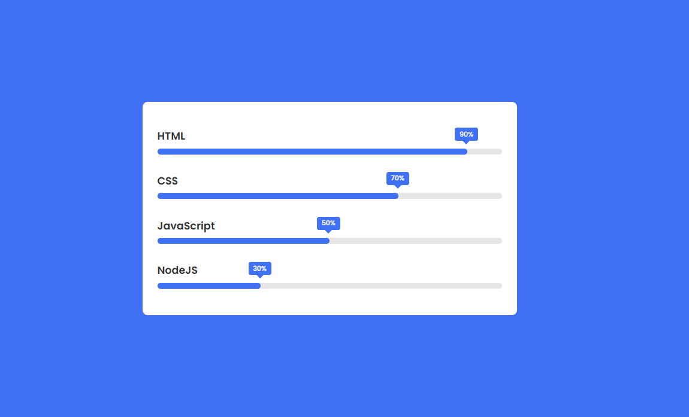

# 📊 Barra de Progresso Animada

Projeto de barras de progresso animadas, desenvolvido com **HTML5 e CSS3** como parte de uma atividade prática do curso PROA.

O projeto tem como objetivo explorar conceitos de animações CSS, estilização de componentes visuais e representação de valores percentuais, utilizando barras com preenchimento animado e indicadores personalizados.

## 🖥️ Prévia do projeto

  

🔗 **[Acesse o projeto online](https://gabrielc0liveira.github.io/Projeto7Proa-BarradeProgresso/)**

## Funcionalidades e características

- Exibição de quatro barras de progresso com diferentes porcentagens.
- Representação visual de valores associados a HTML, CSS, JavaScript e NodeJS.
- Animação de preenchimento das barras ao carregar a página.
- Indicadores percentuais posicionados acima de cada barra.
- Animações com diferentes tempos de início utilizando `animation-delay`.
- Layout centralizado com fundo azul e painel branco.
- Interface desenvolvida inteiramente com HTML e CSS, sem JavaScript.

## Tecnologias utilizadas

- **HTML5:** estruturação e organização das barras de progresso e seus indicadores.
- **CSS3:** estilização, posicionamento, animações e representação visual das porcentagens.
- **Google Fonts:** utilização da fonte Poppins.

## Aprendizados

Durante o desenvolvimento, foram praticados conceitos como:

- Estruturação de componentes visuais utilizando HTML.
- Organização e centralização de elementos com Flexbox.
- Criação de animações utilizando `@keyframes` e `animation`.
- Controle do tempo de início das animações com `animation-delay`.
- Manipulação de largura e opacidade para criar efeitos de preenchimento.
- Posicionamento de indicadores utilizando `position: absolute` e `relative`.
- Utilização de pseudoelementos como `::before` para criar detalhes visuais.

## 📂 Como executar o projeto

🔗 **[Acesse o projeto online](https://gabrielc0liveira.github.io/Projeto7Proa-BarradeProgresso/)**

---

Desenvolvido por **Gabriel Oliveira** como parte das atividades práticas do PROA.
